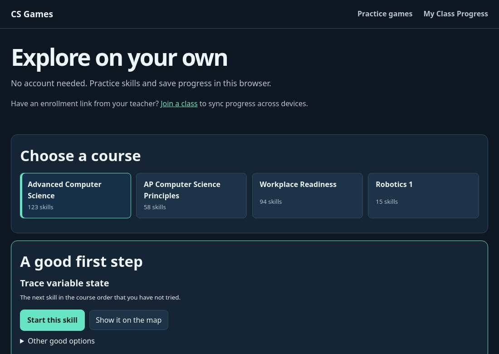
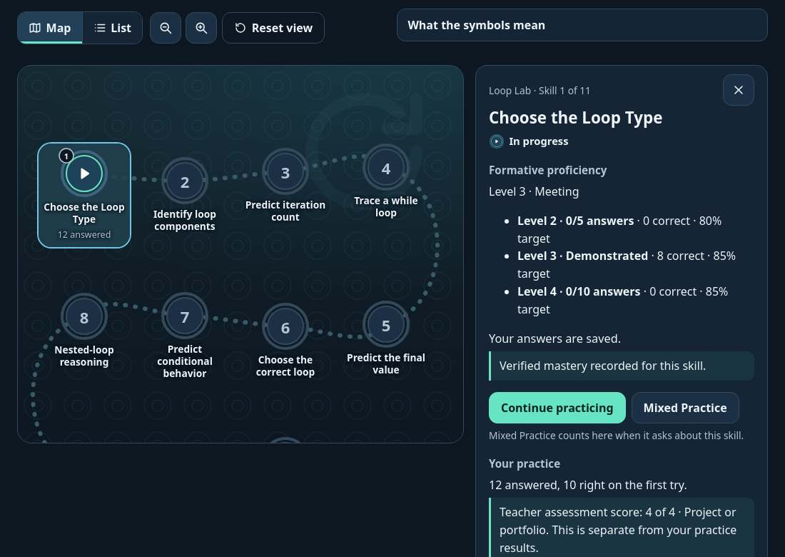
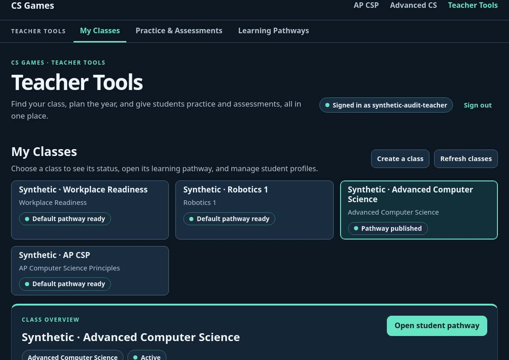

# CS Games static usability review guide

These screenshots show the existing application running against the isolated synthetic dataset. Use them to assess visual hierarchy, labeling, navigation, and information density. Interactive behavior, accessibility, state changes, and task completion require a running browser. The teacher roster identifiers and the student's profile panel are omitted from the captures.

## Independent student

Open the independent map and choose a course. The course view offers a map, a list, and a suggested next step. Selecting an area exposes its skills and links to practice. An interactive audit should answer a question, return to the map, reload, and check the visible progress. Compare where the selected area and skill appear in Map and List.

## Enrolled student

The enrollment link lets students join and save a profile ID and recovery credential. An existing student can restore using both values. The student map shows formative practice and teacher-reviewed results within a checkpoint. An interactive audit should restore a seeded profile, open Loop Lab, record practice, return to the same skill, and restore in a separate browser context.

## Teacher

Teacher Tools opens to class management after sign-in. A class overview links to the pathway editor, mastery requirements, pacing, diagnostics, and student profiles. The roster opens each profile's activity, skill evidence, and assessment form. An interactive audit should edit a requirement, compare the draft with the student view, publish, record a project score, and download a progress report.

For the diagnostic, use the seeded Workplace Readiness class report. For the duplicate summary, open String Lab and compare the lab modal with the course-level printable report. See [verified flows and findings](VERIFICATION.md) for the existing evidence and [launch instructions](CLAUDE_GEMINI_HANDOFF.md) for a live walkthrough.
