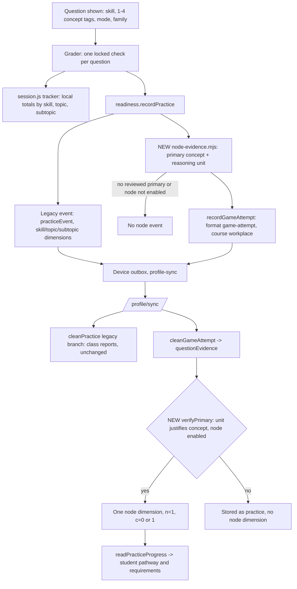

# Workplace Readiness mastery evidence audit

Date: 2026-11-15. Work began on `012aa9cb5abac0966de290a8b90f737a16edc395` (PR #47 merge) and was rebased onto `c8354e7021f8aeac48104c36c288a269d0c69a87` (main after PR #48, the Roundoff repair) when main moved. Branch `fix/claude-wpr-mastery-evidence`, commit `ac56e605bc0b86ab03b1a8ffc9ab91bddd95cb07`. Not pushed, merged or deployed.
Requirement areas touched: CSG-MAS (first attempts, evidence), CSG-CUR (curriculum registration). No specification text was changed.

## 1. Result in one paragraph

Workplace Readiness earned no node-level practice evidence because the page never sent the shared scored-attempt event. That was a missing integration. A second, separate problem is content: questions carry 1 to 4 concept tags and nothing said which one an answer demonstrates. This package adds one reviewed primary concept per reasoning unit, sends and verifies node evidence for it, and enables 30 of the 94 skills. The other 64 stay teacher-assessed, each with a stated reason.

## 2. Evidence flow (before and after)

Before this change the right-hand branch (node-evidence onward) did not exist for Workplace Readiness, so `readPracticeProgress` never saw a Workplace Readiness node.

## 3. Affected components

| Component | Role | Finding | Change |
|---|---|---|---|
| `js/core/generator.js`, `js/compose/engine.js` | Build questions | Every question carries all tags of its template or kit; composed questions expose kit and rule in `cx` | None |
| `js/core/grader.js`, `js/app/ui.js` | Score answers | One check, then locked. No skip, reveal or hint control exists | None |
| `js/app/session.js` | Local session totals | Counts every tag (correct for reports) | None |
| `online/readiness.mjs` | Calls the profile queue | Sent the legacy event only | Also calls the node adapter |
| `online/profile-model.mjs` `practiceEvent` | Legacy class report event | Skill, topic and subtopic dimensions; no node | None |
| `online/profile-sync.mjs` `recordGameAttempt` | Shared scored-attempt queue | Never called by Workplace Readiness | Reused as is |
| `online/node-evidence.mjs` | New adapter | n/a | New |
| `cs-games/pathway/evidence.mjs` `questionEvidence` | Maps an event to nodes | No Workplace Readiness branch; mode selectors never match concept nodes | 6-line `workplace` branch |
| `cs-games/pathway/wpr-primary-concepts.mjs` | Attribution table and checks | n/a | New |
| `cs-games/pathway/mastery/wpr-automatic.mjs` | Enabled skills and tiers | n/a | New (data) |
| `cs-games/pathway/requirements/recommended.mjs` | Starting requirement tiers (PR #46) | All 94 skills had no tier | Enabled skills get their tier |
| `service/profile-evidence.mjs`, `profiles.mjs`, schema | Validation, storage | Already accept the shared event for course `workplace` | None |
| Curriculum graph | 94 nodes with `conceptId` selectors | Sufficient as is | None (290 nodes, unchanged) |

## 4. Content limits versus missing integration

Missing integration (fixed): no scored-attempt event; no rule for which node an answer credits.

Content limits (not fixed, reported):

- 3,169 of 3,284 question units carry more than one tag. Only 115 carry exactly one.
- 846 units earn no node credit: generic cross-kit reasoning (proceed when satisfied, respect dependencies, find the defect, hazard control outside safety kits, protect requirements, consult affected people), three numeric kits whose two tags are always demonstrated together, and 6 authored templates that span their tags equally.
- The earlier figure of a median 51 reasoning signatures per concept counted every signature that carried the tag. Counted by primary concept, skills have between 0 and 11 distinct reasoning units; 40 skills have 1 to 3.
- 4 skills have no question whose primary concept is that skill.

## 5. Node results

| Classification | Skills |
|---|---:|
| Audited | 94 |
| Have objectively scored questions with a reviewed primary concept | 90 |
| Enabled by this package (needed only evidence adaptation) | 30 |
| Need question revision (answer-length shortcut) | 2 |
| Need more primary content or review | 50 |
| of those, enough units but too few high-confidence | 13 |
| Performed behaviour: teacher-reviewed performance (coverage audit's judgment) | 8 |
| No primary content: teacher assessment until content exists | 4 |

Activation rules: at least 4 distinct reasoning units, at least 3 high confidence, at least 2 question modes, at most 10 required questions per reasoning unit at the recommended tier, the longest option correct in at most 50% of sampled choice questions, and the concept is not one of the 8 the merged coverage audit classed as performed behaviour. These are audit heuristics set by me, not calibrated against student data.

### Enabled skills

| Skill | Tier | Reasoning units | High confidence |
|---|---|---:|---:|
| `critical-thinking-and-problem-solving:analyze-problems` | complex-reasoning | 7 | 5 |
| `initiative-and-self-direction:identify-needs` | complex-reasoning | 4 | 3 |
| `integrity:honesty-and-fairness` | complex-reasoning | 11 | 8 |
| `conflict-resolution:diplomatic-negotiation` | complex-reasoning | 7 | 6 |
| `conflict-resolution:when-to-escalate` | complex-reasoning | 5 | 5 |
| `listening-and-speaking:active-listening` | complex-reasoning | 5 | 5 |
| `listening-and-speaking:audience-and-setting` | complex-reasoning | 4 | 4 |
| `respect-for-diversity:individual-differences` | complex-reasoning | 5 | 3 |
| `customer-service-orientation:courteous-knowledgeable` | complex-reasoning | 8 | 7 |
| `teamwork:expectations-roles-goals` | complex-reasoning | 4 | 4 |
| `teamwork:respect-contributions` | complex-reasoning | 4 | 3 |
| `teamwork:team-communication` | complex-reasoning | 4 | 3 |
| `big-picture-thinking:impacts-of-actions` | complex-reasoning | 7 | 5 |
| `career-and-life-management:qualifications-and-advancement` | complex-reasoning | 6 | 3 |
| `career-and-life-management:benefits-and-resources` | complex-reasoning | 4 | 4 |
| `career-and-life-management:wellness-and-finances` | complex-reasoning | 7 | 4 |
| `continuous-learning-and-adaptability:learning-resources` | complex-reasoning | 4 | 3 |
| `continuous-learning-and-adaptability:acting-on-feedback` | complex-reasoning | 5 | 4 |
| `efficiency-and-productivity:prioritize-tasks` | complex-reasoning | 4 | 3 |
| `information-literacy:evaluate-credibility` | complex-reasoning | 10 | 9 |
| `information-security:cyber-threats` | complex-reasoning | 5 | 5 |
| `information-security:security-procedures` | complex-reasoning | 11 | 6 |
| `information-technology:software-and-applications` | complex-reasoning | 10 | 9 |
| `information-technology:cloud-and-file-sharing` | complex-reasoning | 5 | 3 |
| `information-technology:troubleshooting` | complex-reasoning | 7 | 7 |
| `job-specific-tools-and-technologies:safe-use` | complex-reasoning | 9 | 4 |
| `professionalism:etiquette` | standard-practice | 9 | 6 |
| `reading-and-writing:interpret-documents` | complex-reasoning | 9 | 8 |
| `reading-and-writing:clarity` | complex-reasoning | 4 | 3 |
| `workplace-safety:emergency-protocols` | complex-reasoning | 4 | 3 |

### Need question revision

| Skill | Units | Reason |
|---|---:|---|
| `workplace-safety:ppe` | 6 | the longest option is correct in 60% of sampled choice questions |
| `workplace-safety:identify-hazards` | 5 | the longest option is correct in 57% of sampled choice questions |

### Performed behaviour (stay teacher-assessed)

| Skill | Units | Reason |
|---|---:|---|
| `initiative-and-self-direction:minimal-supervision` | 4 | performed behaviour: scenario questions show knowledge of the expectation, not the behaviour; 2 high-confidence unit(s); 3 needed |
| `work-ethic:diligence` | 5 | performed behaviour: scenario questions show knowledge of the expectation, not the behaviour |
| `work-ethic:dependability` | 5 | performed behaviour: scenario questions show knowledge of the expectation, not the behaviour |
| `listening-and-speaking:nonverbal-cues` | 2 | performed behaviour: scenario questions show knowledge of the expectation, not the behaviour; 2 distinct reasoning unit(s); 4 needed; 2 high-confidence unit(s); 3 needed |
| `listening-and-speaking:presenting` | 5 | performed behaviour: scenario questions show knowledge of the expectation, not the behaviour |
| `professionalism:punctuality-attendance` | 2 | performed behaviour: scenario questions show knowledge of the expectation, not the behaviour; 2 distinct reasoning unit(s); 4 needed; 2 high-confidence unit(s); 3 needed |
| `professionalism:self-representation` | 7 | performed behaviour: scenario questions show knowledge of the expectation, not the behaviour; the longest option is correct in 68% of sampled choice questions |
| `professionalism:appearance` | 5 | performed behaviour: scenario questions show knowledge of the expectation, not the behaviour |

### No primary content

| Skill | Units | Reason |
|---|---:|---|
| `critical-thinking-and-problem-solving:implement-action` | 0 | no question has this concept as its primary assessed concept |
| `integrity:laws-and-regulations` | 0 | no question has this concept as its primary assessed concept |
| `integrity:importance-of-integrity` | 0 | no question has this concept as its primary assessed concept |
| `information-security:information-formats` | 0 | no question has this concept as its primary assessed concept |

### Need more content or review

| Skill | Units | Reason |
|---|---:|---|
| `creativity-and-innovation:contribute-ideas` | 3 | 3 distinct reasoning unit(s); 4 needed; 1 high-confidence unit(s); 3 needed |
| `creativity-and-innovation:improve-processes` | 4 | 2 high-confidence unit(s); 3 needed; the longest option is correct in 60% of sampled choice questions |
| `creativity-and-innovation:allocate-resources` | 2 | 2 distinct reasoning unit(s); 4 needed; 2 high-confidence unit(s); 3 needed |
| `creativity-and-innovation:value-of-creativity` | 2 | 2 distinct reasoning unit(s); 4 needed; 1 high-confidence unit(s); 3 needed; 30 questions over 2 reasoning units exceeds 10 per unit |
| `critical-thinking-and-problem-solving:evaluate-solutions` | 2 | 2 distinct reasoning unit(s); 4 needed; 2 high-confidence unit(s); 3 needed |
| `critical-thinking-and-problem-solving:logical-decisions` | 4 | 1 high-confidence unit(s); 3 needed |
| `initiative-and-self-direction:proactive-decisions` | 3 | 3 distinct reasoning unit(s); 4 needed; 0 high-confidence unit(s); 3 needed |
| `initiative-and-self-direction:apply-solutions` | 3 | 3 distinct reasoning unit(s); 4 needed; 2 high-confidence unit(s); 3 needed |
| `integrity:policies-and-procedures` | 4 | 2 high-confidence unit(s); 3 needed |
| `integrity:respect-for-property` | 4 | 2 high-confidence unit(s); 3 needed |
| `work-ethic:accountability` | 4 | 2 high-confidence unit(s); 3 needed |
| `work-ethic:accepting-consequences` | 1 | 1 distinct reasoning unit(s); 4 needed; 1 high-confidence unit(s); 3 needed; 20 questions over 1 reasoning units exceeds 10 per unit |
| `conflict-resolution:work-style-differences` | 2 | 2 distinct reasoning unit(s); 4 needed; 2 high-confidence unit(s); 3 needed |
| `conflict-resolution:performance-concerns` | 4 | 2 high-confidence unit(s); 3 needed |
| `conflict-resolution:personality-and-culture` | 1 | 1 distinct reasoning unit(s); 4 needed; 1 high-confidence unit(s); 3 needed; 30 questions over 1 reasoning units exceeds 10 per unit |
| `respect-for-diversity:valuing-differences` | 3 | 3 distinct reasoning unit(s); 4 needed; 0 high-confidence unit(s); 3 needed |
| `respect-for-diversity:own-bias` | 3 | 3 distinct reasoning unit(s); 4 needed |
| `respect-for-diversity:collaborating` | 5 | 2 high-confidence unit(s); 3 needed |
| `customer-service-orientation:internal-and-external` | 3 | 3 distinct reasoning unit(s); 4 needed; 2 high-confidence unit(s); 3 needed |
| `customer-service-orientation:prioritize-service` | 2 | 2 distinct reasoning unit(s); 4 needed; 0 high-confidence unit(s); 3 needed |
| `customer-service-orientation:anticipate-needs` | 2 | 2 distinct reasoning unit(s); 4 needed; 1 high-confidence unit(s); 3 needed; the longest option is correct in 81% of sampled choice questions |
| `teamwork:share-responsibility` | 2 | 2 distinct reasoning unit(s); 4 needed; 2 high-confidence unit(s); 3 needed |
| `big-picture-thinking:role-in-mission` | 2 | 2 distinct reasoning unit(s); 4 needed; 2 high-confidence unit(s); 3 needed; 50 questions over 2 reasoning units exceeds 10 per unit |
| `big-picture-thinking:organization-structure` | 2 | 2 distinct reasoning unit(s); 4 needed; 2 high-confidence unit(s); 3 needed |
| `big-picture-thinking:community-and-industry` | 2 | 2 distinct reasoning unit(s); 4 needed; 2 high-confidence unit(s); 3 needed |
| `career-and-life-management:smart-goals` | 2 | 2 distinct reasoning unit(s); 4 needed; 2 high-confidence unit(s); 3 needed |
| `continuous-learning-and-adaptability:credentials` | 2 | 2 distinct reasoning unit(s); 4 needed; 2 high-confidence unit(s); 3 needed |
| `continuous-learning-and-adaptability:changing-requirements` | 4 | 2 high-confidence unit(s); 3 needed |
| `efficiency-and-productivity:work-plan` | 4 | 1 high-confidence unit(s); 3 needed |
| `efficiency-and-productivity:adapt-goals` | 2 | 2 distinct reasoning unit(s); 4 needed; 2 high-confidence unit(s); 3 needed |
| `efficiency-and-productivity:human-resources` | 2 | 2 distinct reasoning unit(s); 4 needed; 1 high-confidence unit(s); 3 needed |
| `efficiency-and-productivity:capital-resources` | 2 | 2 distinct reasoning unit(s); 4 needed; 2 high-confidence unit(s); 3 needed; the longest option is correct in 63% of sampled choice questions |
| `efficiency-and-productivity:natural-resources` | 2 | 2 distinct reasoning unit(s); 4 needed; 1 high-confidence unit(s); 3 needed; 30 questions over 2 reasoning units exceeds 10 per unit |
| `information-literacy:locate-sources` | 1 | 1 distinct reasoning unit(s); 4 needed; 1 high-confidence unit(s); 3 needed; 20 questions over 1 reasoning units exceeds 10 per unit |
| `information-literacy:judge-relevance` | 2 | 2 distinct reasoning unit(s); 4 needed; 2 high-confidence unit(s); 3 needed |
| `information-literacy:use-information` | 4 | 1 high-confidence unit(s); 3 needed |
| `information-security:ethical-technology-use` | 1 | 1 distinct reasoning unit(s); 4 needed; 0 high-confidence unit(s); 3 needed; 1 question mode(s); 2 needed; 20 questions over 1 reasoning units exceeds 10 per unit |
| `information-security:acceptable-use` | 2 | 2 distinct reasoning unit(s); 4 needed; 2 high-confidence unit(s); 3 needed; 50 questions over 2 reasoning units exceeds 10 per unit |
| `information-security:confidentiality` | 4 | 2 high-confidence unit(s); 3 needed |
| `information-technology:hardware-and-devices` | 1 | 1 distinct reasoning unit(s); 4 needed; 1 high-confidence unit(s); 3 needed; 1 question mode(s); 2 needed; 50 questions over 1 reasoning units exceeds 10 per unit |
| `information-technology:emerging-technology` | 1 | 1 distinct reasoning unit(s); 4 needed; 1 high-confidence unit(s); 3 needed; 1 question mode(s); 2 needed; 20 questions over 1 reasoning units exceeds 10 per unit |
| `job-specific-tools-and-technologies:select-right-tool` | 3 | 3 distinct reasoning unit(s); 4 needed |
| `mathematics:basic-calculations` | 2 | 2 distinct reasoning unit(s); 4 needed; 0 high-confidence unit(s); 3 needed; 50 questions over 2 reasoning units exceeds 10 per unit |
| `mathematics:job-task-math` | 3 | 3 distinct reasoning unit(s); 4 needed; 1 high-confidence unit(s); 3 needed |
| `mathematics:personal-finance` | 3 | 3 distinct reasoning unit(s); 4 needed; 1 high-confidence unit(s); 3 needed |
| `reading-and-writing:tone-and-audience` | 3 | 3 distinct reasoning unit(s); 4 needed |
| `reading-and-writing:conventions` | 3 | 3 distinct reasoning unit(s); 4 needed; 2 high-confidence unit(s); 3 needed |
| `workplace-safety:safety-guidelines` | 4 | 2 high-confidence unit(s); 3 needed |
| `workplace-safety:safety-data-sheets` | 3 | 3 distinct reasoning unit(s); 4 needed |
| `workplace-safety:universal-precautions` | 1 | 1 distinct reasoning unit(s); 4 needed; 1 high-confidence unit(s); 3 needed; 1 question mode(s); 2 needed; 20 questions over 1 reasoning units exceeds 10 per unit |

## 6. Requirement tiers

Tiers come from the questions: the share of credited units that are decision, next-step or ordering questions above Beginner. 29 enabled skills are Complex Reasoning (20 at 90%) and 1 is Standard Practice (30 at 90%). None is Quick Recognition. Workplace Readiness has scenario judgement questions and no recognition drills, so I did not spread skills across tiers artificially. No preset number was changed. Class, area and skill overrides work as before.

## 7. Question quality (12,000 generated questions, student-visible text only; figures are for the 37 skills that passed the unit, confidence, mode and feasibility rules)

- Every option has an explanation and every wrong option has a named misconception (0 missing).
- Answer position is balanced (892 / 886 / 910 / 860 over 3,548 choice questions).
- The longest option is correct in 31% of choice questions across those skills (chance is 25%), and the shortest in 5%. Three skills exceeded 50% (self-representation, PPE, identify-hazards) and were not enabled.
- Every enabled skill appears in all 13 career contexts and at least 23 settings. Scenario length averages 30 to 64 words, at most 15 words per sentence.
- Not checked by measurement: stereotype review, realism, and whether each scenario has one defensible best answer. I read the template patterns and kit rules to assign primaries, not every rendered scenario. No educator has reviewed the questions or the table.

## 8. Limits

- The attribution table is my reading of each unit's reasoning. 258 entries are marked high confidence and 106 medium. It needs educator review before the enabled list is treated as settled.
- Existing classes keep their published pathways: their Workplace Readiness checkpoints stay teacher-assessed until the teacher changes them. New classes created with recommended requirements get the 30 tiers.
- Live production sign-in and synchronization were not tested. Sync was tested against the local dev service only.
- One browser engine (Chromium 153). No screen-reader pass; the page UI did not change.
- Guests: no node evidence is recorded for guest practice (unchanged; the guest coverage matrix still says so).
