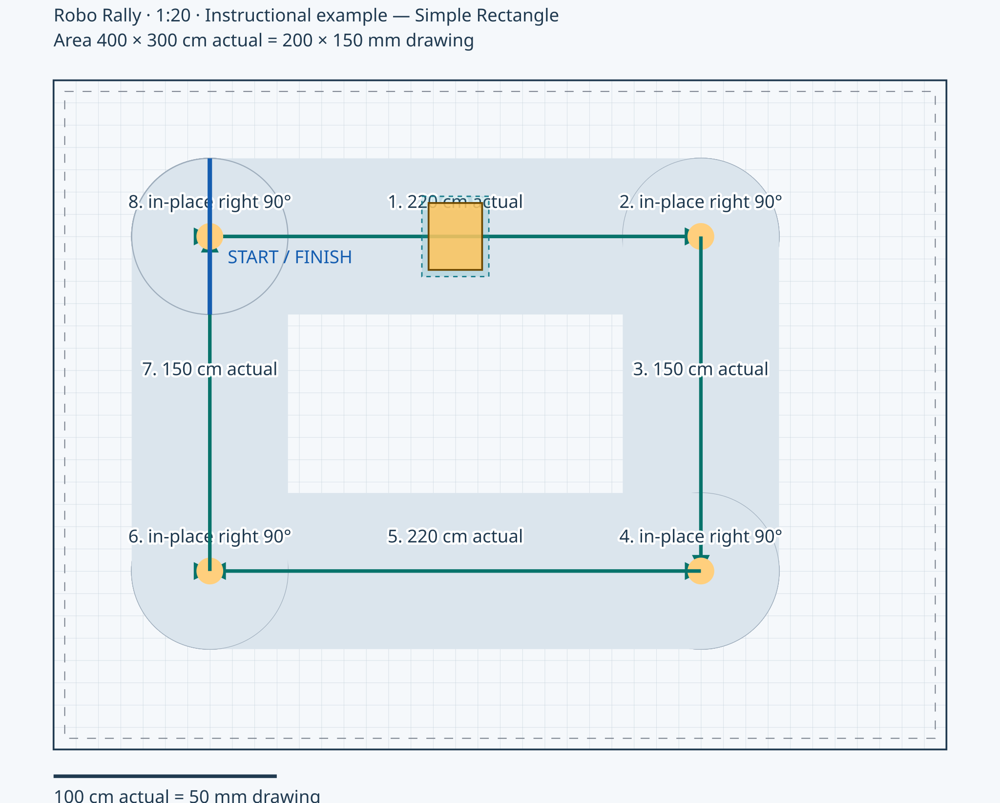
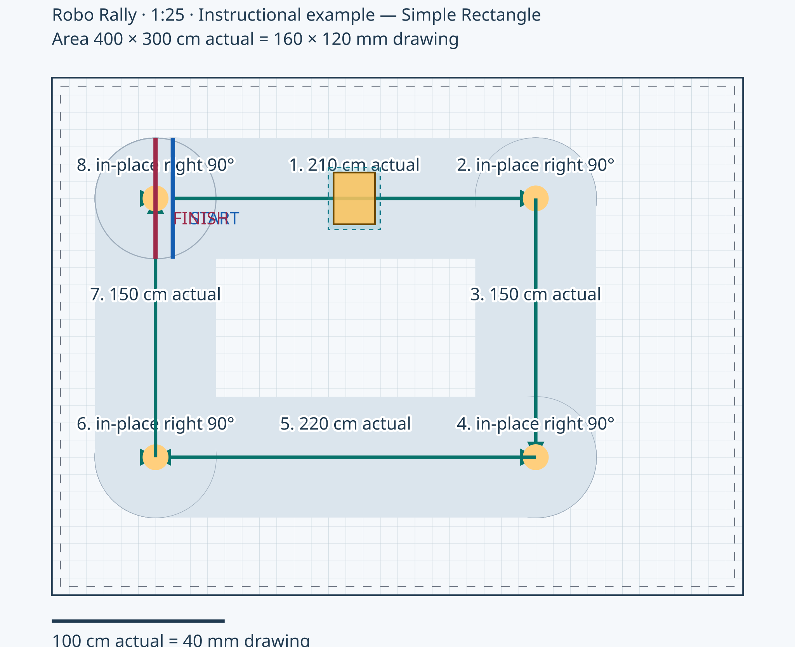

## Robo Rally Course Architect — Engineering Test 1

Date: 2026-10-29T12:00:00Z

Project: Instructional example — Simple Rectangle

**Objective:** Fit paper

**Measurements:** Robot 30 cm wide × 24 cm long; safety clearance 3 cm per side. Example measurements only. Replace with measurements of your own robot and classroom. Available floor 400 cm × 300 cm, wall margin 5 cm. Default corridor 70 cm. Start (70 cm, 70 cm), heading 0°.

**Selected scale:** 1:20. One cm on drawing represents 20 cm in reality. A larger denominator makes a smaller drawing.

**Calculations:** Drawing distance = actual distance ÷ N. Actual distance = drawing distance × N. Scale factor N = actual ÷ drawing (same units).

- Floor width: 400 cm × 10 mm/cm = 4000 mm; 4000 ÷ 20 = 200 mm on drawing.
- Floor length: 3000 ÷ 20 = 150 mm on drawing.
- Robot width: 300 ÷ 20 = 15 mm on drawing.
- Robot length: 240 ÷ 20 = 12 mm on drawing.
- Sheet 279.4 × 215.9 mm; margin 10 mm; usable 259.4 × 195.9 mm. Required denominator = max(4000/259.4, 3000/195.9) = 15.4202.

**Course design**

| Segment | Geometry | Actual path | Drawing path | Endpoint (mm) |
|---|---|---|---|---|
| 1 | straight; lane 70 cm | 220 cm | 110 mm | (2900, 700) |
| 2 | rotate right 90°; lane 70 cm | 0 cm | 0 mm | (2900, 700) |
| 3 | straight; lane 70 cm | 150 cm | 75 mm | (2900, 2200) |
| 4 | rotate right 90°; lane 70 cm | 0 cm | 0 mm | (2900, 2200) |
| 5 | straight; lane 70 cm | 220 cm | 110 mm | (700, 2200) |
| 6 | rotate right 90°; lane 70 cm | 0 cm | 0 mm | (700, 2200) |
| 7 | straight; lane 70 cm | 150 cm | 75 mm | (700, 700) |
| 8 | rotate right 90°; lane 70 cm | 0 cm | 0 mm | (700, 700) |

Total path = 740 cm; drawing path = 370 mm. In-place turns add zero translational path length. Minimum lane surplus after body+safety = 23.1385 cm. Estimated minimum turning radius: 30 cm. In-place capability: selected, verify physically.

**Obstacles:** None entered.

**Scaled drawing:** Upload the downloaded diagram into the same notebook folder, or update this relative image path. The app has not uploaded it.

**Prediction:** The smaller drawing fits.

**Digital test results**

| Check | Outcome | Evidence / revision guidance |
|---|---|---|
| drawing | Pass | Full measured area requires 200 × 150 mm on paper; usable region 259.4 × 195.9 mm. Fits at the selected scale. |
| drawing-annotations | Pass | Annotated SVG size 224 × 180 mm, including labels. Fits whole sheet; print at 100% and verify the scale bar. |
| consistency | Pass | Connected geometry is recomputed from the start pose. Start and finish are marked. |
| clearance | Pass | Segment 1: straight corridor width 700 mm; rectangular body plus safety needs 360 mm. Geometric width condition passes. |
| physical | Pass | Segment 1: body safety envelope and rounded corridor remain inside wall margins. |
| obstacles | Pass | Segment 1: no robot-envelope or corridor intersection with entered obstacles. |
| clearance | Pass | Segment 2: rotation-pad diameter 700 mm; rectangular body plus safety needs 468.615 mm. Geometric width condition passes. |
| turning | Warning | Segment 2: In-place rotation capability selected; verify it with the real drivetrain. Required body rotation disk: 468.615 mm. |
| physical | Pass | Segment 2: body safety envelope and rounded corridor remain inside wall margins. |
| obstacles | Pass | Segment 2: no robot-envelope or corridor intersection with entered obstacles. |
| clearance | Pass | Segment 3: straight corridor width 700 mm; rectangular body plus safety needs 360 mm. Geometric width condition passes. |
| physical | Pass | Segment 3: body safety envelope and rounded corridor remain inside wall margins. |
| obstacles | Pass | Segment 3: no robot-envelope or corridor intersection with entered obstacles. |
| clearance | Pass | Segment 4: rotation-pad diameter 700 mm; rectangular body plus safety needs 468.615 mm. Geometric width condition passes. |
| turning | Warning | Segment 4: In-place rotation capability selected; verify it with the real drivetrain. Required body rotation disk: 468.615 mm. |
| physical | Pass | Segment 4: body safety envelope and rounded corridor remain inside wall margins. |
| obstacles | Pass | Segment 4: no robot-envelope or corridor intersection with entered obstacles. |
| clearance | Pass | Segment 5: straight corridor width 700 mm; rectangular body plus safety needs 360 mm. Geometric width condition passes. |
| physical | Pass | Segment 5: body safety envelope and rounded corridor remain inside wall margins. |
| obstacles | Pass | Segment 5: no robot-envelope or corridor intersection with entered obstacles. |
| clearance | Pass | Segment 6: rotation-pad diameter 700 mm; rectangular body plus safety needs 468.615 mm. Geometric width condition passes. |
| turning | Warning | Segment 6: In-place rotation capability selected; verify it with the real drivetrain. Required body rotation disk: 468.615 mm. |
| physical | Pass | Segment 6: body safety envelope and rounded corridor remain inside wall margins. |
| obstacles | Pass | Segment 6: no robot-envelope or corridor intersection with entered obstacles. |
| clearance | Pass | Segment 7: straight corridor width 700 mm; rectangular body plus safety needs 360 mm. Geometric width condition passes. |
| physical | Pass | Segment 7: body safety envelope and rounded corridor remain inside wall margins. |
| obstacles | Pass | Segment 7: no robot-envelope or corridor intersection with entered obstacles. |
| clearance | Pass | Segment 8: rotation-pad diameter 700 mm; rectangular body plus safety needs 468.615 mm. Geometric width condition passes. |
| turning | Warning | Segment 8: In-place rotation capability selected; verify it with the real drivetrain. Required body rotation disk: 468.615 mm. |
| physical | Pass | Segment 8: body safety envelope and rounded corridor remain inside wall margins. |
| obstacles | Pass | Segment 8: no robot-envelope or corridor intersection with entered obstacles. |
| method | Warning | Floor/obstacle checks use rectangle SAT at adaptive poses ≤5 mm maximum corner travel and ≤1° heading, with a conservative ≤2.5 mm per-side guard. Near contacts can fail conservatively. Width checks use an analytic rectangular-body envelope. Endpoint/junction pads are automatically widened to at least the robot safety diagonal and must be built; crossings are permitted. Verify tape boundaries and driving physically. |
| physical-test | Not evaluated | Digital geometry does not confirm physical navigation. Build and drive the course, then record observations. |

**Observations:** Width failed

**Design changes:** Increase N

**Reasoning:** Paper is fixed

**Reflection / next test:** Test the real robot next.

Physical navigation has not been recorded for this test.

---

## Robo Rally Course Architect — Engineering Test 2

Date: 2026-10-29T12:01:00Z

Project: Instructional example — Simple Rectangle

**Objective:** Fit paper

**Measurements:** Robot 30 cm wide × 24 cm long; safety clearance 3 cm per side. Example measurements only. Replace with measurements of your own robot and classroom. Available floor 400 cm × 300 cm, wall margin 5 cm. Default corridor 70 cm. Start (70 cm, 70 cm), heading 0°.

**Selected scale:** 1:25. One cm on drawing represents 25 cm in reality. A larger denominator makes a smaller drawing.

**Calculations:** Drawing distance = actual distance ÷ N. Actual distance = drawing distance × N. Scale factor N = actual ÷ drawing (same units).

- Floor width: 400 cm × 10 mm/cm = 4000 mm; 4000 ÷ 25 = 160 mm on drawing.
- Floor length: 3000 ÷ 25 = 120 mm on drawing.
- Robot width: 300 ÷ 25 = 12 mm on drawing.
- Robot length: 240 ÷ 25 = 9.6 mm on drawing.
- Sheet 279.4 × 215.9 mm; margin 10 mm; usable 259.4 × 195.9 mm. Required denominator = max(4000/259.4, 3000/195.9) = 15.4202.

**Course design**

| Segment | Geometry | Actual path | Drawing path | Endpoint (mm) |
|---|---|---|---|---|
| 1 | straight; lane 70 cm | 210 cm | 84 mm | (2800, 700) |
| 2 | rotate right 90°; lane 70 cm | 0 cm | 0 mm | (2800, 700) |
| 3 | straight; lane 70 cm | 150 cm | 60 mm | (2800, 2200) |
| 4 | rotate right 90°; lane 70 cm | 0 cm | 0 mm | (2800, 2200) |
| 5 | straight; lane 70 cm | 220 cm | 88 mm | (600, 2200) |
| 6 | rotate right 90°; lane 70 cm | 0 cm | 0 mm | (600, 2200) |
| 7 | straight; lane 70 cm | 150 cm | 60 mm | (600, 700) |
| 8 | rotate right 90°; lane 70 cm | 0 cm | 0 mm | (600, 700) |

Total path = 730 cm; drawing path = 292 mm. In-place turns add zero translational path length. Minimum lane surplus after body+safety = 23.1385 cm. Estimated minimum turning radius: 30 cm. In-place capability: selected, verify physically.

**Obstacles:** None entered.

**Scaled drawing:** Upload the downloaded diagram into the same notebook folder, or update this relative image path. The app has not uploaded it.

**Prediction:** The smaller drawing fits.

**Digital test results**

| Check | Outcome | Evidence / revision guidance |
|---|---|---|
| drawing | Pass | Full measured area requires 160 × 120 mm on paper; usable region 259.4 × 195.9 mm. Fits at the selected scale. |
| drawing-annotations | Pass | Annotated SVG size 184 × 150 mm, including labels. Fits whole sheet; print at 100% and verify the scale bar. |
| consistency | Pass | Connected geometry is recomputed from the start pose. Start and finish are marked. |
| clearance | Pass | Segment 1: straight corridor width 700 mm; rectangular body plus safety needs 360 mm. Geometric width condition passes. |
| physical | Pass | Segment 1: body safety envelope and rounded corridor remain inside wall margins. |
| obstacles | Pass | Segment 1: no robot-envelope or corridor intersection with entered obstacles. |
| clearance | Pass | Segment 2: rotation-pad diameter 700 mm; rectangular body plus safety needs 468.615 mm. Geometric width condition passes. |
| turning | Warning | Segment 2: In-place rotation capability selected; verify it with the real drivetrain. Required body rotation disk: 468.615 mm. |
| physical | Pass | Segment 2: body safety envelope and rounded corridor remain inside wall margins. |
| obstacles | Pass | Segment 2: no robot-envelope or corridor intersection with entered obstacles. |
| clearance | Pass | Segment 3: straight corridor width 700 mm; rectangular body plus safety needs 360 mm. Geometric width condition passes. |
| physical | Pass | Segment 3: body safety envelope and rounded corridor remain inside wall margins. |
| obstacles | Pass | Segment 3: no robot-envelope or corridor intersection with entered obstacles. |
| clearance | Pass | Segment 4: rotation-pad diameter 700 mm; rectangular body plus safety needs 468.615 mm. Geometric width condition passes. |
| turning | Warning | Segment 4: In-place rotation capability selected; verify it with the real drivetrain. Required body rotation disk: 468.615 mm. |
| physical | Pass | Segment 4: body safety envelope and rounded corridor remain inside wall margins. |
| obstacles | Pass | Segment 4: no robot-envelope or corridor intersection with entered obstacles. |
| clearance | Pass | Segment 5: straight corridor width 700 mm; rectangular body plus safety needs 360 mm. Geometric width condition passes. |
| physical | Pass | Segment 5: body safety envelope and rounded corridor remain inside wall margins. |
| obstacles | Pass | Segment 5: no robot-envelope or corridor intersection with entered obstacles. |
| clearance | Pass | Segment 6: rotation-pad diameter 700 mm; rectangular body plus safety needs 468.615 mm. Geometric width condition passes. |
| turning | Warning | Segment 6: In-place rotation capability selected; verify it with the real drivetrain. Required body rotation disk: 468.615 mm. |
| physical | Pass | Segment 6: body safety envelope and rounded corridor remain inside wall margins. |
| obstacles | Pass | Segment 6: no robot-envelope or corridor intersection with entered obstacles. |
| clearance | Pass | Segment 7: straight corridor width 700 mm; rectangular body plus safety needs 360 mm. Geometric width condition passes. |
| physical | Pass | Segment 7: body safety envelope and rounded corridor remain inside wall margins. |
| obstacles | Pass | Segment 7: no robot-envelope or corridor intersection with entered obstacles. |
| clearance | Pass | Segment 8: rotation-pad diameter 700 mm; rectangular body plus safety needs 468.615 mm. Geometric width condition passes. |
| turning | Warning | Segment 8: In-place rotation capability selected; verify it with the real drivetrain. Required body rotation disk: 468.615 mm. |
| physical | Pass | Segment 8: body safety envelope and rounded corridor remain inside wall margins. |
| obstacles | Pass | Segment 8: no robot-envelope or corridor intersection with entered obstacles. |
| method | Warning | Floor/obstacle checks use rectangle SAT at adaptive poses ≤5 mm maximum corner travel and ≤1° heading, with a conservative ≤2.5 mm per-side guard. Near contacts can fail conservatively. Width checks use an analytic rectangular-body envelope. Endpoint/junction pads are automatically widened to at least the robot safety diagonal and must be built; crossings are permitted. Verify tape boundaries and driving physically. |
| physical-test | Not evaluated | Digital geometry does not confirm physical navigation. Build and drive the course, then record observations. |

**Observations:** Width failed

**Design changes:** Increase N

**Reasoning:** Paper is fixed

**Reflection / next test:** Test the real robot next.

**Comparison with preceding selected test:** Scale: 1:20 → 1:25; Available area: 4000 × 3000 mm → 4000 × 3000 mm; Course bounds: 2900 × 2200 mm → 2900 × 2200 mm; Straight lengths: 2200, —, 1500, —, 2200, —, 1500, — mm → 2100, —, 1500, —, 2200, —, 1500, — mm; Turn radii: —, —, —, —, —, —, —, — mm → —, —, —, —, —, —, —, — mm; Total length: 7400 mm → 7300 mm; Narrowest lane surplus: 231.385 mm → 231.385 mm; Turns below estimate: 0 → 0; Failures: 0 → 0; Warnings: 5 → 5; Drawing fit: Pass → Pass; Resolved problems: None → ; New problems:  → None

Physical navigation has not been recorded for this test.

---

## Robo Rally Course Architect — Engineering Test 3

Date: 2026-10-29T12:02:00Z

Project: Instructional example — Simple Rectangle

**Objective:** Fit paper

**Measurements:** Robot 30 cm wide × 24 cm long; safety clearance 3 cm per side. Example measurements only. Replace with measurements of your own robot and classroom. Available floor 400 cm × 300 cm, wall margin 5 cm. Default corridor 70 cm. Start (70 cm, 70 cm), heading 0°.

**Selected scale:** 1:25. One cm on drawing represents 25 cm in reality. A larger denominator makes a smaller drawing.

**Calculations:** Drawing distance = actual distance ÷ N. Actual distance = drawing distance × N. Scale factor N = actual ÷ drawing (same units).

- Floor width: 400 cm × 10 mm/cm = 4000 mm; 4000 ÷ 25 = 160 mm on drawing.
- Floor length: 3000 ÷ 25 = 120 mm on drawing.
- Robot width: 300 ÷ 25 = 12 mm on drawing.
- Robot length: 240 ÷ 25 = 9.6 mm on drawing.
- Sheet 279.4 × 215.9 mm; margin 10 mm; usable 259.4 × 195.9 mm. Required denominator = max(4000/259.4, 3000/195.9) = 15.4202.

**Course design**

| Segment | Geometry | Actual path | Drawing path | Endpoint (mm) |
|---|---|---|---|---|
| 1 | straight; lane 70 cm | 210 cm | 84 mm | (2800, 700) |
| 2 | rotate right 90°; lane 70 cm | 0 cm | 0 mm | (2800, 700) |
| 3 | straight; lane 70 cm | 150 cm | 60 mm | (2800, 2200) |
| 4 | rotate right 90°; lane 70 cm | 0 cm | 0 mm | (2800, 2200) |
| 5 | straight; lane 70 cm | 220 cm | 88 mm | (600, 2200) |
| 6 | rotate right 90°; lane 70 cm | 0 cm | 0 mm | (600, 2200) |
| 7 | straight; lane 70 cm | 150 cm | 60 mm | (600, 700) |
| 8 | rotate right 90°; lane 70 cm | 0 cm | 0 mm | (600, 700) |

Total path = 730 cm; drawing path = 292 mm. In-place turns add zero translational path length. Minimum lane surplus after body+safety = 23.1385 cm. Estimated minimum turning radius: 30 cm. In-place capability: selected, verify physically.

**Obstacles:** None entered.

**Scaled drawing:** Upload the downloaded diagram into the same notebook folder, or update this relative image path. The app has not uploaded it.

**Prediction:** The smaller drawing fits.

**Digital test results**

| Check | Outcome | Evidence / revision guidance |
|---|---|---|
| drawing | Pass | Full measured area requires 160 × 120 mm on paper; usable region 259.4 × 195.9 mm. Fits at the selected scale. |
| drawing-annotations | Pass | Annotated SVG size 184 × 150 mm, including labels. Fits whole sheet; print at 100% and verify the scale bar. |
| consistency | Pass | Connected geometry is recomputed from the start pose. Start and finish are marked. |
| clearance | Pass | Segment 1: straight corridor width 700 mm; rectangular body plus safety needs 360 mm. Geometric width condition passes. |
| physical | Pass | Segment 1: body safety envelope and rounded corridor remain inside wall margins. |
| obstacles | Pass | Segment 1: no robot-envelope or corridor intersection with entered obstacles. |
| clearance | Pass | Segment 2: rotation-pad diameter 700 mm; rectangular body plus safety needs 468.615 mm. Geometric width condition passes. |
| turning | Warning | Segment 2: In-place rotation capability selected; verify it with the real drivetrain. Required body rotation disk: 468.615 mm. |
| physical | Pass | Segment 2: body safety envelope and rounded corridor remain inside wall margins. |
| obstacles | Pass | Segment 2: no robot-envelope or corridor intersection with entered obstacles. |
| clearance | Pass | Segment 3: straight corridor width 700 mm; rectangular body plus safety needs 360 mm. Geometric width condition passes. |
| physical | Pass | Segment 3: body safety envelope and rounded corridor remain inside wall margins. |
| obstacles | Pass | Segment 3: no robot-envelope or corridor intersection with entered obstacles. |
| clearance | Pass | Segment 4: rotation-pad diameter 700 mm; rectangular body plus safety needs 468.615 mm. Geometric width condition passes. |
| turning | Warning | Segment 4: In-place rotation capability selected; verify it with the real drivetrain. Required body rotation disk: 468.615 mm. |
| physical | Pass | Segment 4: body safety envelope and rounded corridor remain inside wall margins. |
| obstacles | Pass | Segment 4: no robot-envelope or corridor intersection with entered obstacles. |
| clearance | Pass | Segment 5: straight corridor width 700 mm; rectangular body plus safety needs 360 mm. Geometric width condition passes. |
| physical | Pass | Segment 5: body safety envelope and rounded corridor remain inside wall margins. |
| obstacles | Pass | Segment 5: no robot-envelope or corridor intersection with entered obstacles. |
| clearance | Pass | Segment 6: rotation-pad diameter 700 mm; rectangular body plus safety needs 468.615 mm. Geometric width condition passes. |
| turning | Warning | Segment 6: In-place rotation capability selected; verify it with the real drivetrain. Required body rotation disk: 468.615 mm. |
| physical | Pass | Segment 6: body safety envelope and rounded corridor remain inside wall margins. |
| obstacles | Pass | Segment 6: no robot-envelope or corridor intersection with entered obstacles. |
| clearance | Pass | Segment 7: straight corridor width 700 mm; rectangular body plus safety needs 360 mm. Geometric width condition passes. |
| physical | Pass | Segment 7: body safety envelope and rounded corridor remain inside wall margins. |
| obstacles | Pass | Segment 7: no robot-envelope or corridor intersection with entered obstacles. |
| clearance | Pass | Segment 8: rotation-pad diameter 700 mm; rectangular body plus safety needs 468.615 mm. Geometric width condition passes. |
| turning | Warning | Segment 8: In-place rotation capability selected; verify it with the real drivetrain. Required body rotation disk: 468.615 mm. |
| physical | Pass | Segment 8: body safety envelope and rounded corridor remain inside wall margins. |
| obstacles | Pass | Segment 8: no robot-envelope or corridor intersection with entered obstacles. |
| method | Warning | Floor/obstacle checks use rectangle SAT at adaptive poses ≤5 mm maximum corner travel and ≤1° heading, with a conservative ≤2.5 mm per-side guard. Near contacts can fail conservatively. Width checks use an analytic rectangular-body envelope. Endpoint/junction pads are automatically widened to at least the robot safety diagonal and must be built; crossings are permitted. Verify tape boundaries and driving physically. |
| physical-test | Not evaluated | Digital geometry does not confirm physical navigation. Build and drive the course, then record observations. |

**Observations:** Width failed

**Design changes:** Increase N

**Reasoning:** Paper is fixed

**Reflection / next test:** Test the real robot next.

**Comparison with preceding selected test:** Scale: 1:25 → 1:25; Available area: 4000 × 3000 mm → 4000 × 3000 mm; Course bounds: 2900 × 2200 mm → 2900 × 2200 mm; Straight lengths: 2100, —, 1500, —, 2200, —, 1500, — mm → 2100, —, 1500, —, 2200, —, 1500, — mm; Turn radii: —, —, —, —, —, —, —, — mm → —, —, —, —, —, —, —, — mm; Total length: 7300 mm → 7300 mm; Narrowest lane surplus: 231.385 mm → 231.385 mm; Turns below estimate: 0 → 0; Failures: 0 → 0; Warnings: 5 → 5; Drawing fit: Pass → Pass; Resolved problems: None → ; New problems:  → None

**Recorded physical test** (2026-10-29): Navigation outcome: Partly. Struggles: SYNTHETIC TEST FIXTURE ONLY — no robot was physically tested. Second turn. Measurement differences: 2 cm. Adjustments: Widened lane. Improvement: Not yet retested.
